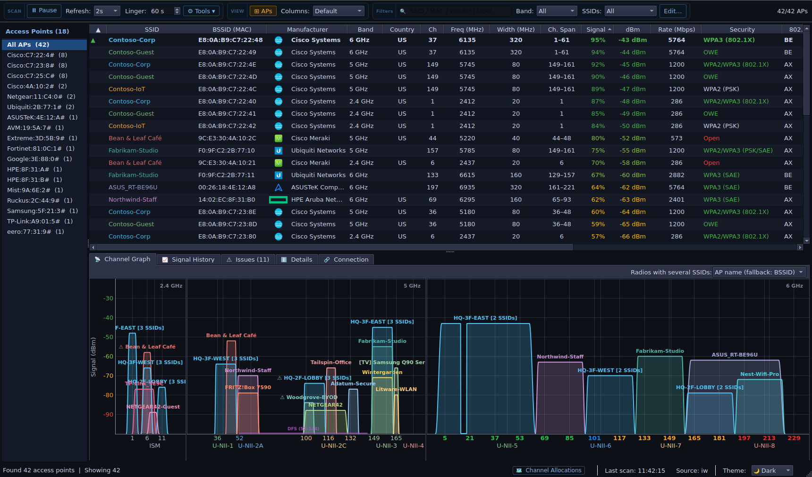

# WaveScope

> A modern, fast WiFi analyzer for Linux and macOS — built with PyQt6 and Python.



---

## About

WaveScope is an open-source WiFi analyzer for Linux and macOS desktops. It gives you a real-time view of the wireless networks around you — from signal strength and channel occupancy to security modes, WiFi generations, and manufacturer data. Linux uses `iw` / NetworkManager; macOS uses Apple's public CoreWLAN framework. Available detail depends on the platform, adapter and access point (see the platform table below).

> 🤖 This application was built mostly using **Claude Code AI** (by Anthropic), with iterative development driven by human feedback.

---

## Features

- 📡 **Real-time channel graph** — per-band panels (2.4 GHz / 5 GHz / 6 GHz), no dead spectrum
- 📈 **Signal history plot** — rolling 2-minute time series per access point
- 🔍 **Rich AP metadata** — SSID, BSSID, manufacturer (OUI), band, channel, bandwidth, signal (dBm), security, WiFi generation, channel utilization, connected clients, 802.11k/v/r roaming support
- 🧰 **Troubleshooting tools** — Issues tab (configuration problems with explanations), side-by-side Compare, per-BSSID labels with wildcards, column profiles with pinned columns, Find AP beeper, saved sessions and CSV export; all preferences in one Settings dialog
- 🎯 **Native scan data** — Linux reads the kernel's scan cache via `iw`, cross-checked against Wireshark, with NetworkManager triggering scans; macOS reads CoreWLAN scan results directly
- 🧭 **RF analysis** — per-channel congestion score, HE BSS-color collision alerts, roam candidates for the connected SSID, SNR and per-antenna RSSI for the current link
- 📶 **Wi-Fi 6E / 7 detail** — 6 GHz PSC markers and AP power type (LPI/SP/VLP), 320 MHz channels, EHT puncturing drawn on the graph, multi-link (MLD) grouping, co-located 6 GHz APs from the Reduced Neighbor Report
- 🔐 **Security detail** — WPA3 Personal/Enterprise/192-bit modes, SAE-EXT-KEY, SAE H2E/SAE-PK (RSNX), OWE transition pairs, 802.11r mobility domain
- 🏢 **AP name from vendor IEs** — physical AP names read from Cisco (IE 133), Aruba and Ubiquiti beacon IEs, shown in an **AP Name** column
- 📶 **TX power column** — per-AP transmit power from Cisco IE 150, Ruckus vendor IE and the standard 802.11h TPC Report
- 🗂️ **AP group sidebar** — groups the BSSIDs/radios of each physical AP; click a group to filter the table to it
- ⭐ **Known SSIDs** — keep a list of your own/notable SSIDs, then show only or hide them with one filter
- 🎨 **Dark / Light / Auto theme**
- 🏷️ **DFS channel indicator** — subtle amber marker on DFS channels in the 5 GHz band
- 🔒 **Manufacturer lookup** — IEEE OUI database (downloaded on demand, bundled fallback), WPS data and vendor IEs; detects Cisco Meraki from its vendor IE when the OUI database has no entry for newer hardware
- 🖼️ **Vendor icons** — logos for recognized manufacturers
- ⚡ **Configurable refresh rate** — 1s to 10s
- 💾 **Settings are saved between sessions** — theme, refresh interval, column widths and window layout
- 🩺 **Platform-aware startup checks** — checks Linux tools or macOS framework bindings and explains Location Services requirements
- 🖱️ **Interactive graphs** — click labels to highlight, scroll to zoom, drag to pan
- 🔎 **Filter & sort** — by any column, with text search
- 📦 **Packet capture (Linux)** — two modes available via the toolbar:
  - **Monitor Mode**: raw 802.11 over-the-air capture of all frames on a chosen channel (all devices); temporarily disconnects WiFi, restored automatically on stop
  - **Managed Mode**: capture your own machine's traffic without disconnecting from the network; WiFi stays connected throughout
  - Both modes output standard `.pcap` files (Wireshark-compatible) and require a single root prompt

---

## Platform

| | Linux | macOS |
|---|---|---|
| **Installation** | `.deb` (Debian 12+, Ubuntu 24.04+), `.rpm` (Fedora, openSUSE), AppImage (x86_64, glibc 2.35+), source | Source or locally built `.app`, native Apple Silicon / Intel |
| **Scan backend** | `iw`; NetworkManager (`nmcli`) triggers scans | CoreWLAN through PyObjC; Location Services permission and a properly signed executable |
| **Python** | 3.10 or newer | 3.10 or newer, with compatible Python / Qt / PyObjC wheels for your macOS release |
| **Network list, signal history, channel graph, filters, manufacturer lookup** | Yes | Yes, subject to CoreWLAN / adapter support |
| **Sessions, CSV export, comparison, labels, Find AP** | Yes | Yes |
| **Connected-link telemetry** | Driver-dependent rates, counters, SNR, survey and antenna data | CoreWLAN connection details, transmit rate, RSSI, noise and SNR when available |
| **Detailed beacon / PHY metadata** | Full `iw` parser | RSN / PMF, BSS load, country, DTIM, 802.11k/v/r and PHY generation when advertised; vendor AP names / transmit power, RNR, MLD and HE color are not decoded |
| **Maximum PHY rate** | Derived from advertised capabilities | Left unavailable when it cannot be determined; the current link rate is shown separately |
| **Packet capture** | `tcpdump` + polkit (`pkexec`), managed and monitor modes | Not implemented; capture controls are disabled |

macOS CI covers imports, tests and `.app` builds on macOS 15 for Apple Silicon and Intel. It does not validate live scanning or the Location Services prompt. A built `.app` targets the architecture and macOS release used to build it; older releases depend on the Python and Qt versions installed.

---

## Installation

### Option A — Debian/Ubuntu (.deb package) ✅ Recommended

Download `wavescope_<version>_all.deb` from the [Releases](https://github.com/yurividal/WaveScope/releases) page:

```bash
sudo apt install ./wavescope_*_all.deb
wavescope
```

Requires Debian 12+ or Ubuntu 24.04+: the package uses the distro's `python3-pyqt6`, which Ubuntu 22.04 does not ship. On Ubuntu 22.04, use the AppImage (Option D) or run from source (Option E).

During installation a Python virtual environment is created in `/opt/wavescope/.venv` that uses the distro PyQt6, and `pyqtgraph` + `numpy` are installed into it from PyPI (versions pinned in `constraints.txt`). **This step needs internet access.** If it fails (offline, proxy, PyPI down), the package still installs and prints a warning. Fix it later with:

```bash
sudo /opt/wavescope/setup-venv.sh
```

**System dependencies** (pulled in automatically, from the package's `Depends:`):
```
python3 (>= 3.10), python3-pip, python3-venv, python3-pyqt6, pyqt6-dev-tools,
network-manager, iw, tcpdump, polkitd | policykit-1 | polkit | pkexec,
libxcb-cursor0, libxcb-xinerama0, libxcb-randr0
```
(`pyqt6-dev-tools` is there because it contains the `PyQt6.uic` module that pyqtgraph imports.)

---

### Option B — Fedora / RHEL (.rpm package) ✅ Recommended

Download `wavescope-<version>-1.fcNN.noarch.rpm` from the [Releases](https://github.com/yurividal/WaveScope/releases) page:

```bash
sudo dnf install ./wavescope-*.fc*.noarch.rpm
wavescope
```

Just like the .deb, `%post` sets up `/opt/wavescope/.venv` from PyPI (needs internet access; if it fails, the package still installs and you can re-run `sudo /opt/wavescope/setup-venv.sh`).

**System dependencies** (from the spec's `Requires:`):
```
python3 >= 3.10, python3-pip, python3-pyqt6, NetworkManager, iw, tcpdump,
polkit, xcb-util-cursor
```

---

### Option C — openSUSE (.rpm package) ✅ Recommended

Download `wavescope-<version>-1.opensuse.noarch.rpm` from the [Releases](https://github.com/yurividal/WaveScope/releases) page (Tumbleweed; Leap works if it provides Python >= 3.10 and PyQt6):

```bash
sudo zypper install --allow-unsigned-rpm ./wavescope-*.opensuse.noarch.rpm
wavescope
```

Same `/opt/wavescope/.venv` setup as above (needs internet access; recovery: `sudo /opt/wavescope/setup-venv.sh`).

**System dependencies** (from the spec's `Requires:`):
```
python3 >= 3.10, python3-pip, python3-qt6, NetworkManager, iw, tcpdump,
polkit, libxcb-cursor0, libgthread-2_0-0
```

---

### Option D — AppImage

Download `WaveScope-<version>-x86_64.AppImage` from the [Releases](https://github.com/yurividal/WaveScope/releases) page:

```bash
chmod +x WaveScope-*-x86_64.AppImage
./WaveScope-*-x86_64.AppImage
```

Notes:
- The AppImage bundles Python, PyQt6, pyqtgraph, numpy and `iw` (6.17). It is built on Ubuntu 22.04 and needs glibc 2.35 or newer.
- Scanning works without any host tools. NetworkManager (`nmcli`) is only used to trigger fresh scans; without it the app shows the kernel's scan cache. Packet capture needs the host's `iw`, `tcpdump` and `pkexec`.

---

### Option E — Run from source

```bash
# Clone
git clone https://github.com/yurividal/WaveScope.git
cd WaveScope

# Install & run (creates .venv, installs packages)
chmod +x install.sh
./install.sh
./wavescope
```

`install.sh` detects **apt** (Debian/Ubuntu), **dnf** (Fedora) or **zypper** (openSUSE), lists any missing system packages together with the command to install them (and offers to run it when started from a terminal), and warns if `nmcli`, `iw`, `tcpdump` or `pkexec` is missing. On other distros it prints what to install by hand. It then creates `.venv` with PyQt6, pyqtgraph and numpy from PyPI (pinned by `constraints.txt`), writes the `./wavescope` launcher and adds a desktop entry for your user.

---

### Option F — macOS

Install a current, signed Python from [python.org](https://www.python.org/downloads/macos/), then run:

```bash
git clone https://github.com/yurividal/WaveScope.git
cd WaveScope
./install.sh
./wavescope
```

On macOS, `install.sh` installs the Qt dependencies and PyObjC bindings in `.venv`. It skips Linux package managers, `nmcli`, `iw`, polkit and Linux desktop files. To select a particular Python before creating the virtual environment, use `WAVESCOPE_PYTHON=/path/to/python3 ./install.sh`.

**Location Services and signing:** macOS protects Wi-Fi names and BSSIDs as location-sensitive information. A signed `.app` requests permission on first launch. A source interpreter without location usage descriptions must already have access; WaveScope displays guidance instead of making an invalid permission request. Check **System Settings → Privacy & Security → Location Services** for WaveScope or the Python / terminal application used to launch it, and restart WaveScope after changing permissions. The UI reports blocked or redacted scan data rather than treating it as an empty neighborhood.

CoreWLAN also requires a properly signed executable. The [PyObjC CoreWLAN notes](https://pyobjc.readthedocs.io/en/latest/apinotes/CoreWLAN.html) explicitly exclude ad-hoc signatures; a Homebrew Python or ad-hoc `.app` can still return redacted identifiers after a location grant. Source launches with signed python.org Python are a development option, but the permission's application identity depends on the launcher. For a stable WaveScope identity and its own permission prompt, [build a signed `.app`](#macos-app) using an Apple-issued signing identity. No root access or deprecated `airport` command is needed.

---

## Build packages from source

### macOS `.app`

Build on a Mac with the same architecture as the intended users:

```bash
./install.sh
.venv/bin/python -m pip install -r requirements-macos-build.txt

# Use an Apple-issued identity already present in your macOS keychain.
WAVESCOPE_CODESIGN_IDENTITY="Developer ID Application: Your Name (TEAMID)" \
  ./scripts/build_macos.sh
open dist/WaveScope.app
```

The build bundles Python, Qt, PyObjC, vendor data and icons. It sets the application identifier to `io.github.yurividal.WaveScope`, includes the Location Services usage descriptions, and verifies the code signature. When a signing identity is supplied, PyInstaller enables the hardened runtime; the included entitlement allows the executable callbacks required by PyObjC ([PyObjC signing notes](https://pyobjc.readthedocs.io/en/latest/notes/codesigning.html)). Signing identities and credentials are not included in the repository.

Without `WAVESCOPE_CODESIGN_IDENTITY`, the script creates an ad-hoc signed development bundle for UI and build checks. **That bundle is not a guarantee of working live Wi-Fi scans.** Public distribution also needs the maintainer's signing and notarization process; this repository does not publish macOS release assets automatically. Build Apple Silicon and Intel packages separately. The script accepts an optional `X.Y.Z` version and `WAVESCOPE_PYTHON` to select the build environment.

To check the packaged UI and assets without requesting location access or scanning:

```bash
QT_QPA_PLATFORM=offscreen dist/WaveScope.app/Contents/MacOS/WaveScope --smoke-test
```

### .deb (Debian/Ubuntu)

```bash
# Requires: dpkg-dev
chmod +x scripts/build_deb.sh
./scripts/build_deb.sh
sudo apt install ./wavescope_*_all.deb
```

### .rpm (Fedora/RHEL)

```bash
# Requires: rpm-build
# sudo dnf install rpm-build
chmod +x scripts/build_rpm.sh
./scripts/build_rpm.sh
sudo dnf install ./wavescope-*.fc*.noarch.rpm
```

### .rpm (openSUSE)

```bash
# Requires: rpm-build
# sudo zypper install -y rpm-build
chmod +x scripts/build_opensuse.sh
./scripts/build_opensuse.sh
sudo zypper install --allow-unsigned-rpm ./wavescope-*.noarch.rpm
```

### AppImage

```bash
# Requires: appimagetool
# (Download from AppImageKit releases or install from your distro if available)
chmod +x scripts/build_appimage.sh
./scripts/build_appimage.sh

chmod +x WaveScope-*.AppImage
./WaveScope-*.AppImage
```

### AppImage (Docker, no host appimagetool needed)

Builds inside the same Ubuntu 22.04 image as the release CI (`scripts/docker/appimage-builder.Dockerfile`), running as your user so the output is not root-owned:

```bash
# Requires: docker
./scripts/build_appimage_docker.sh          # optional: pass a version, e.g. 2.0.1
./scripts/test_appimage_xvfb.sh WaveScope-*-x86_64.AppImage   # launch test on a bare Ubuntu 22.04 (Xvfb)

chmod +x WaveScope-*.AppImage
./WaveScope-*.AppImage
```

Manual equivalent:

```bash
docker build -t wavescope-appimage-builder:22.04 \
    -f scripts/docker/appimage-builder.Dockerfile scripts/docker
docker run --rm --user "$(id -u):$(id -g)" -e HOME=/tmp \
    -v "$PWD:/work" -w /work \
    wavescope-appimage-builder:22.04 ./scripts/build_appimage.sh
```

---

## Requirements

### Linux system packages
- `nmcli` — provided by `network-manager`
- `iw` — for enriched scan data (WiFi generation, exact dBm, BSS load, etc.)
- `tcpdump` — required for packet capture (Monitor & Managed modes)
- `pkexec` — from polkit (`pkexec`/`polkitd`/`policykit-1` on Debian/Ubuntu, `polkit` on Fedora/openSUSE); required for root privilege during packet capture

### macOS system requirements

- A Wi-Fi adapter exposed by CoreWLAN and compatible Python / Qt wheels
- Location Services enabled and granted to the application
- A properly signed Python executable or WaveScope `.app` for Wi-Fi identifiers

### Python packages
- `PyQt6 >= 6.4.0` (from PyPI for source installs and the AppImage; from the distro for .deb/.rpm)
- `pyqtgraph >= 0.13.0`
- `numpy >= 1.23.0`
- `pyobjc-framework-CoreWLAN` and `pyobjc-framework-CoreLocation` (macOS only)

`requirements.txt` has the minimum versions. `constraints.txt` pins the exact versions that every install method uses.

---

## Contributing
See [CONTRIBUTING.md](CONTRIBUTING.md) for dev setup, linting, adding vendor IE parsers and packaging.

---

## Changelog
See [CHANGELOG.md](CHANGELOG.md) for release history.

---

## License

MIT License. See [LICENSE](LICENSE).
